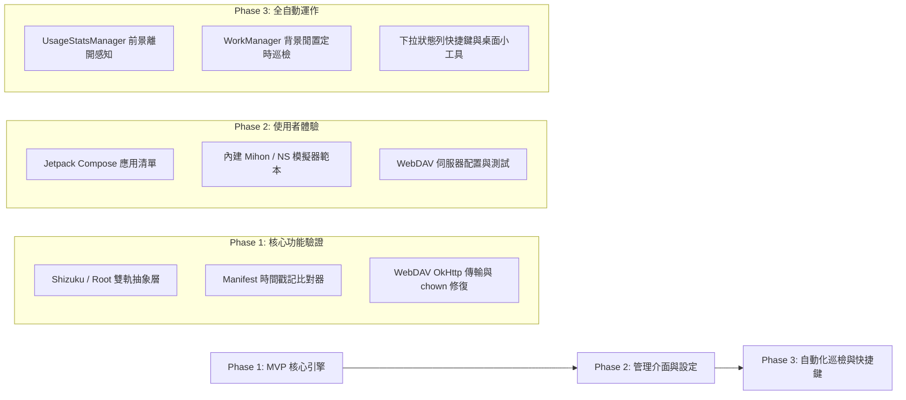

# DroidSaveSync (Android 雲端存檔自動同步系統)

> **專為多裝置玩家與重度用戶打造的 Android 輕量級、跨裝置資料與存檔自動同步系統（類似 Steam Cloud for Android）。**

---

## 📖 專案背景與核心痛點

在 Android 多裝置環境（如實體手機、平板、電腦 Android 模擬器）之間切換使用時，資料同步長期存在以下痛點：

1. **Mihon 漫畫閱讀進度**：
   - 官方雖然具備本機備份功能，但換裝置閱讀時必須「手動匯入還原」，體驗繁瑣且不連貫；自架伺服器方案又無法兼顧離線閱讀的核心優勢。
2. **模擬器與單機遊戲存檔（NS 模擬器、離線手遊）**：
   - 在電腦模擬器（如雷電、MuMu）玩了一段進度，出門想用手機接續遊玩時，存檔往往鎖在系統內部 `/data/data/` 沙盒中，無法直接傳輸。
3. **日常輸入法與工具詞庫（如 Rime / Trime）**：
   - 跨裝置詞庫與個人化設定缺乏即時雙向同步機制。
4. **現成工具的局限性**：
   - **Tasker**：為單機授權的付費軟體，多裝置（實體機 + 多個模擬器）部署成本高且繁瑣。
   - **DataBackup（笨蛋備份）**：偏向災難性整機搬移，不支援「雙端時間戳記自動比對」與「背景自動感應同步」，仍需大量手動操作。

---

## 🎯 產品定位與核心價值

`DroidSaveSync` 定位為一個**通用型、全自動、以時間戳記比對為核心**的跨裝置同步系統：

- **Steam Cloud 級體驗**：遊戲或應用結束後自動備份，換裝置開啟前自動比對拉取最新存檔，完全無感銜接。
- **通用應用框架**：不限於特定應用，任何 Android App 皆可登錄同步清單。
- **免 Root 支援（Shizuku 提權）**：未解鎖的實體手機透過 Shizuku 無線除錯即可無痛讀寫 `/data/data/`；已 Root 裝置（如模擬器）則自動降級走 `su` 執行。
- **智慧去噪過濾**：自動剔除 `cache/` 與 `code_cache/`，將幾百 MB 的無效快取壓縮至僅幾十 KB 至數 MB 的關鍵存檔，節省 95% 傳輸頻寬。
- **全自動權限修復**：異機還原時自動重配 Linux UID / GID（`chown`）與 SELinux 安全標籤，杜絕權限錯位造成的應用閃退。
- **標準 WebDAV 儲存**：後端採用公有標準 WebDAV 協定，相容於個人 NAS、Nextcloud 或各類免費雲端空間。

---

## ⚖️ 現有解決方案對比表

| 評估維度 | 手動備份 + 網盤 | Tasker 腳本流 | DataBackup (笨蛋備份) | **DroidSaveSync (本專案)** |
| :--- | :--- | :--- | :--- | :--- |
| **自動比對雙端時間戳記** | ❌ 無 | ⚠️ 需複雜自訂變數 | ❌ 無（僅手動清單） | ✅ **核心功能 (自動判斷最新)** |
| **離線使用與快照防護** | ❌ 易覆蓋舊檔 | ⚠️ 需額外刻邏輯 | ⚠️ 依賴手動還原 | ✅ **自動滾動保留本地 3 版備份** |
| **免 Root (Shizuku) 支援** | ❌ 無法讀沙盒 | ⚠️ 需配置 ADB Wi-Fi | ✅ 支援 | ✅ **原生支援 (雙軌自動切換)** |
| **多裝置免授權自由部署** | ✅ 免費 | ❌ 每台裝置需授權 | ✅ 免費開源 | ✅ **完全免授權自由安裝** |
| **操作繁瑣度** | 極高 (手動複製還原) | 低 (但維護門檻高) | 中 (需進入 App 手動點擊) | **極低 (背景自動化 / 一鍵無感)** |

---

## 🗺️ 產品開發路標 (Roadmap)

---

## 📚 相關技術文件

- [系統架構書與決策記錄 (docs/ARCHITECTURE.md)](docs/ARCHITECTURE.md)

