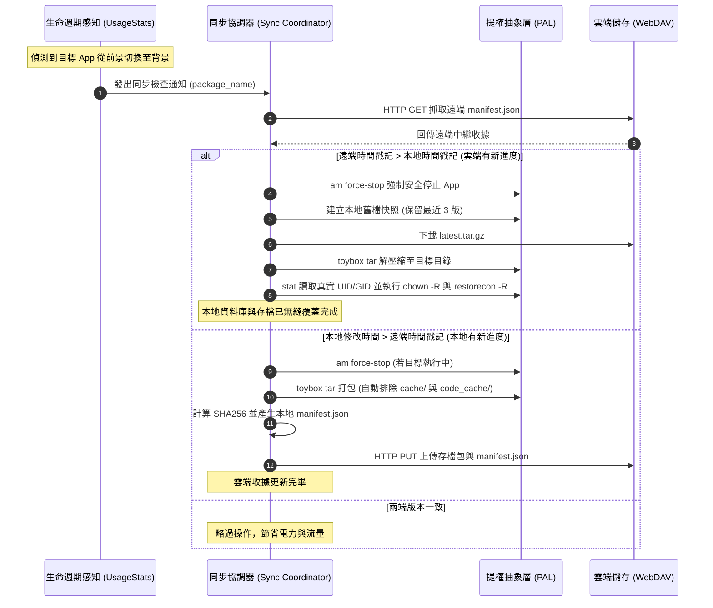

# SaveSync 系統架構書 (System Architecture Document)

本文件定義 `SaveSync` 之系統架構、元件分層、通訊流程與關鍵架構決策記錄 (Architecture Decision Records, ADR)。

---

## 一、 系統架構與分層 (System Architecture)

系統整體架構採乾淨的分層設計 (Layered Architecture)，確保各層級職責分離且易於進行單元測試：

```mermaid
flowchart TD
    subgraph UI_Layer [表現層 (Presentation Layer)]
        UI[Jetpack Compose UI (AppList / Settings)]
        Tile[Quick Settings Tile (快捷磁貼)]
        Widget[App Widget (桌面捷徑小工具)]
    end

    subgraph Service_Layer [調度與生命週期層 (Service & Orchestration Layer)]
        SyncCoordinator[Sync Coordinator (同步調度核心)]
        Worker[WorkManager (背景定期定條件巡檢)]
        Watcher[AppLifecycleWatcher (UsageStats 前景切換感知)]
    end

    subgraph Domain_Layer [領域邏輯層 (Domain & Logic Layer)]
        Comparator[Timestamp & Hash Comparator (時間戳記與校驗比對器)]
        Filter[Cache Filter (快取去噪過濾器)]
        Rollback[Rollback Manager (本地滾動備份管理器)]
    end

    subgraph Infra_Layer [基礎設施與提權層 (Infrastructure & Privilege Layer)]
        PAL[Privilege Abstraction Layer (PAL)]
        ShizukuExec[Shizuku Binder Executor]
        RootExec[Root Su Shell Executor]
        WebDAVClient[WebDAV Client (OkHttp)]
    end

    UI_Layer --> Service_Layer
    Service_Layer --> Domain_Layer
    Domain_Layer --> Infra_Layer
    PAL --> ShizukuExec
    PAL --> RootExec
```

---

## 二、 核心同步資料流 (Core Sync Sequence)



---

## 三、 架構決策記錄 (Architecture Decision Records, ADR)

### ADR-01: 提權引擎採用「Shizuku + Root 雙軌抽象層」
- **現狀背景**：實體手機日常未解鎖 Bootloader，但支援開啟無線除錯與 Shizuku；電腦端模擬器（雷電、MuMu）則標配 Root 權限。
- **決策內容**：
  定義統一的介面 `ShellExecutor`，於應用啟動時依序探測：
  1. 優先探測 `Shizuku.pingBinder()` 是否可用。
  2. 若無，則探測 `su` 指令是否可用。
  3. 若皆無，則僅允許操作標準外置儲存目錄（如 `/sdcard/`）。
- **影響評估**：徹底打破單一環境限制，一套 APK 即可適用所有 Android 實體機與模擬器環境。

---

### ADR-02: 存檔比對採用「雲端公佈欄 Manifest 帳本機制」
- **現狀背景**：Linux 檔案系統的修改時間（`mtime`）在打包、解壓縮與跨時區環境下極易產生誤差（Jitter）；若直接下載數十 MB 的存檔進行全文 Hash 比對，將造成嚴重的網路頻寬與電量浪費。
- **決策內容**：
  引入微型中繼檔案 `manifest.json`，在每次同步成功時同步推送。
- **中繼資料規範 (Schema)**：
  ```json
  {
    "schema_version": 1,
    "package_name": "app.mihon",
    "device_name": "Pixel 8 Pro",
    "updated_at_epoch_ms": 1794503000000,
    "save_version": 42,
    "sha256": "e3b0c44298fc1c149afbf4c8996fb92427ae41e4649b934ca495991b7852b855",
    "archive_size_bytes": 11264,
    "relative_paths": [
      "databases/tachiyomi.db*",
      "shared_prefs/"
    ]
  }
  ```
- **影響評估**：每次輪詢比對只需下載小於 1 KB 的 JSON 檔案，比對耗時小於 100 ms。

---

### ADR-03: 智慧去噪過濾管線 (Cache Stripping Pipeline)
- **現狀背景**：一般備份軟體直接備份 `/data/data/<pkg>/`，會將 WebView 快取、圖片縮圖、Glide 暫存等龐大雜訊一併包入，導致備份檔動輒數百 MB。
- **決策內容**：
  打包管線強制注入預設排除清單：
  ```sh
  toybox tar -czf [目標] --exclude='cache' --exclude='code_cache' --exclude='no_backup' -C [來源] .
  ```
- **影響評估**：大幅將傳輸體積縮減 90%~98%，Mihon 與離線遊戲存檔壓縮後普遍僅需 200 KB ~ 5 MB。

---

### ADR-04: 異機還原權限規格化 (Ownership & SELinux Normalization)
- **現狀背景**：跨裝置還原最常見的崩潰原因為 Linux 使用者 UID/GID 錯位，導致應用程式無法讀取檔案而拋出 `Permission Denied`。
- **決策內容**：
  解壓縮完成後，必須強制執行標準三步驟：
  1. 取得目標目錄身分：`TARGET_ID=$(stat -c "%u:%g" /data/data/<pkg>)`
  2. 遞迴校正檔案擁有者：`chown -R $TARGET_ID /data/data/<pkg>`
  3. 重建 SELinux 安全上下文：`restorecon -R /data/data/<pkg>`
- **影響評估**：確保還原後應用程式能直接啟動且不閃退。

---

### ADR-05: 防衛性關閉與三版滾動回滾 (Safety Rollback)
- **現狀背景**：若在應用程式執行中直接抽換底層 SQLite 資料庫，會引發快取髒寫入或資料庫損毀；若雲端檔案傳輸中斷，可能造成本地存檔遺失。
- **決策內容**：
  - 覆寫前強制發送 `am force-stop <package_name>`。
  - 在執行任何下載覆蓋前，強制將本地現有存檔壓縮留存於 `/sdcard/Android/data/com.droidsave.sync/backups/<pkg>/` 目錄下，維持最多 3 個版本輪替。
- **影響評估**：即便網路斷線或雲端存檔損壞，使用者皆可一鍵復原至前一次本地狀態。

---

## 四、 關鍵 Shell 指令管線標準

| 階段 | 標準指令 | 說明 |
| :--- | :--- | :--- |
| **程序凍結** | `am force-stop <pkg>` | 確保記憶體快取完全刷回磁碟並釋放 DB 鎖 |
| **身分探測** | `stat -c "%u %g" /data/data/<pkg>` | 動態取得本機為該應用分配的 UID 與 GID |
| **去噪打包** | `toybox tar -czf <dest> --exclude='cache' --exclude='code_cache' -C <dir> .` | 排除快取後輕量壓縮 |
| **解包覆蓋** | `toybox tar -xzf <src> -C <dest_dir>` | 解壓縮存檔檔案 |
| **權限歸位** | `chown -R <uid>:<gid> <target> && restorecon -R <target>` | 修復 Linux 擁有者與安全標籤 |

